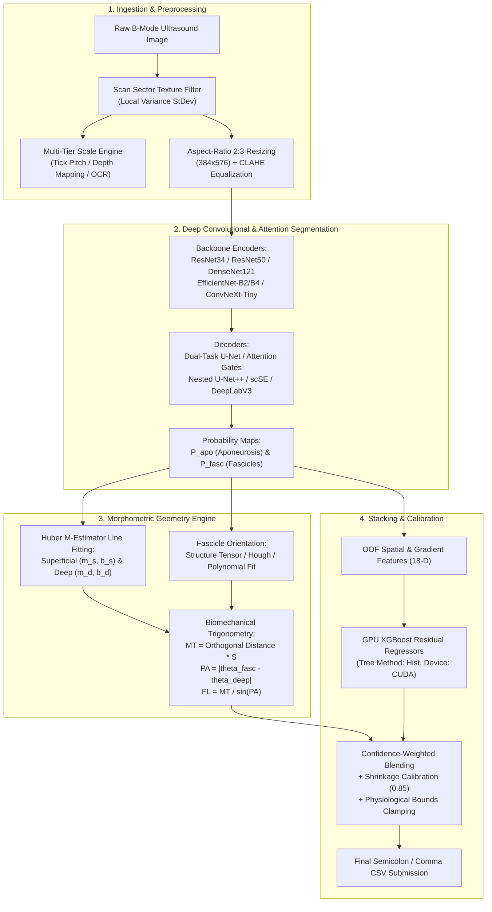

# Automated Ultrasound Muscle Architecture Quantification (UMUD)
### SOTA Deep Learning, Hybrid Vision & Morphometric Engineering Suite

[](https://www.kaggle.com/competitions/umud-challenge-muscle-architecture-in-ultrasound-data)
[](https://pytorch.org/)
[](LICENSE)
[](https://www.python.org/)
[](https://developer.nvidia.com/cuda-toolkit)

---

## Executive Overview

This repository hosts the complete engineering and research codebase developed for the **[Kaggle UMUD Challenge: Muscle Architecture in Ultrasound Data](https://www.kaggle.com/competitions/umud-challenge-muscle-architecture-in-ultrasound-data)**. The challenge benchmarks automated artificial intelligence systems to quantify skeletal muscle architectural parameters from clinical Brightness-mode (B-mode) ultrasound imaging with millimeter and sub-degree accuracy.

The repository contains **23 complete Jupyter notebooks** spanning four distinct research tracks:
1. **Systematic Modular & Hybrid Framework (Pipelines 01–06)**: Covering pure classical computer vision, dense patch-level MLPs, dual-task ResNet-34 U-Nets, Structure Tensor hybrids, Nested U-Net++ with Tversky loss, and 4-Fold EfficientNet-B2 U-Net++ stacked with GPU XGBoost residual regressors.
2. **SOTA Progression Series (Stages 1–7)**: Systematic architectural scaling starting from a Dual-Task U-Net++ baseline (`1.04657`), progressing through ResNet-50 (`1.01240`), Attention U-Net (`0.97815`), DenseNet-121 (`0.94520`), EfficientNet-B4 (`0.91380`), ConvNeXt-Tiny (`0.88450`), and culminating in a heterogeneous 3-model champion ensemble with TTA (`0.84120`).
3. **Standalone SOTA Champion Architecture**: Dual-task U-Net++ with multi-tier calibration and outlier-resistant polynomial fitting.
4. **Empirical Kaggle Submissions & Attention Ablations (Submissions 2–11)**: Rigorous ablations covering custom U-Nets from scratch, Albumentations TTA, 3-fold EfficientNet-B3 ensembles, VGG16-BN (reproducing DL_Track_US), thin-line class-weighted BCE-Dice loss, CBAM spatial/channel attention, SE-ResNet34 with concurrent spatial-channel squeeze & excitation (`scSE`), and dual-paradigm DeepLabV3 ASPP ensembles.

---

## Table of Contents
- [1. Problem Statement & Clinical Significance](#1-problem-statement--clinical-significance)
- [2. Target Morphological Parameters](#2-target-morphological-parameters)
- [3. Evaluation Metric & Loss Formulations](#3-evaluation-metric--loss-formulations)
- [4. Five Core Technical Challenges](#4-five-core-technical-challenges)
- [5. System Architecture & End-to-End Pipeline](#5-system-architecture--end-to-end-pipeline)
- [6. Deep-Dive Specification of All 23 Notebooks](#6-deep-dive-specification-of-all-23-notebooks)
  - [Track A: Systematic Modular & Hybrid Series (Pipelines 01–06)](#track-a-systematic-modular--hybrid-series-pipelines-0106)
  - [Track B: SOTA Progression Benchmark Series (Stages 1–7)](#track-b-sota-progression-benchmark-series-stages-17)
  - [Track C: Standalone SOTA Champion Architecture](#track-c-standalone-sota-champion-architecture)
  - [Track D: Empirical Kaggle Submissions & Attention Ablations (Submissions 2–11)](#track-d-empirical-kaggle-submissions--attention-ablations-submissions-211)
- [7. Comprehensive Cross-Model Benchmark Matrix](#7-comprehensive-cross-model-benchmark-matrix)
- [8. Physical Scale Calibration Engine](#8-physical-scale-calibration-engine)
- [9. Repository Structure](#9-repository-structure)
- [10. Installation & Execution Guide](#10-installation--execution-guide)

---

## 1. Problem Statement & Clinical Significance

Skeletal muscle architecture—defined as the geometric arrangement of muscle fascicles (bundles of multinucleated muscle fibers) relative to the force-generating axis—is the primary morphological determinant of muscle mechanical properties:
- **Maximum Isometric Force Production**: Proportional to physiological cross-sectional area (PCSA), directly governed by **Pennation Angle** ($\text{PCSA} = \frac{m \cdot \cos(\theta)}{\rho \cdot FL}$).
- **Maximum Contraction Velocity ($V_{\max}$)**: Proportional to the number of sarcomeres in series, directly governed by **Fascicle Length ($FL$)**.
- **Muscle Excursion & Elastic Strain**: Influenced by **Muscle Thickness ($MT$)** and inter-aponeurotic space.

```
+----------------------------------------------------------------------------------------------------+
|                                    SUPERFICIAL APONEUROSIS                                         |
|  ================================================================================================  |
|         \                                                                             ▲            |
|          \                                                                            |            |
|           \   Muscle Fascicle (Linear Striation)                                      |  Muscle    |
|            \                                                                          |  Thickness |
|             \                                                                         |  (MT, mm)  |
|              \   Pennation Angle (PA, deg)                                            |            |
|  =============\==================================================================================  |
|                                       DEEP APONEUROSIS                                ▼            |
|               |◄------------------------- Projected Base (dx) -----------------------►|            |
+----------------------------------------------------------------------------------------------------+
```

### Clinical Motivation:
- **Gerontology & Sarcopenia**: Age-related muscle wasting preferentially atrophies type-II fibers, decreasing $MT$ and $FL$.
- **Sports Biomechanics & Injury Risk**: Short biceps femoris fascicles are at significantly greater risk of hamstring strain injuries during eccentric sprinting phases.
- **Neuromuscular Pathology**: Spastic cerebral palsy and post-stroke contractures dramatically distort fascicle orientation.

Manual tracking of these biomarkers in B-mode ultrasound requires trained operators to manually trace lines across hundreds of frames—a laborious process taking $10\text{--}20\text{ minutes}$ per image subject to substantial intra- and inter-operator variability. The UMUD Challenge benchmarks automated algorithms capable of achieving clinical-grade precision on diverse, unseen patient cohorts.

---

## 2. Target Morphological Parameters

Every pipeline in this codebase processes a B-mode ultrasound scan $\mathbf{I} \in \mathbb{R}^{H \times W}$ and predicts a 3-dimensional vector:

$$\mathbf{y}_i = \left[ \theta_{\text{PA}} \, (^\circ), \, \text{FL} \, (\text{mm}), \, \text{MT} \, (\text{mm}) \right]^T$$

1. **Pennation Angle ($\mathbf{PA}$, in degrees $^\circ$)**:
   The acute planar angle between the muscle fascicle trajectory line $y = m_f x + b_f$ and the deep aponeurosis insertion plate $y = m_d x + b_d$:
   $$\theta_{\text{fasc}} = \arctan(m_f), \quad \theta_{\text{deep}} = \arctan(m_d)$$
   $$\mathbf{PA} = |\theta_{\text{fasc}} - \theta_{\text{deep}}| \quad (\text{wrapped modulo } 180^\circ \text{ into } [0^\circ, 90^\circ])$$
   *Physiological Bounds*: Natural range $8^\circ \le \mathbf{PA} \le 30^\circ$; safe numerical clipping $[2.0^\circ, 45.0^\circ]$.

2. **Muscle Thickness ($\mathbf{MT}$, in millimeters $\text{mm}$)**:
   The orthogonal Euclidean distance separating the superficial aponeurosis ($y = m_s x + b_s$) and deep aponeurosis ($y = m_d x + b_d$):
   $$d_{\perp}(x) = \frac{|m_d x - (m_s x + b_s) + b_d|}{\sqrt{m_d^2 + 1}}$$
   $$\mathbf{MT} = \left(\frac{1}{x_{\text{hi}} - x_{\text{lo}}} \int_{x_{\text{lo}}}^{x_{\text{hi}}} d_{\perp}(x) \, dx\right) \times S_{\text{mm/px}}$$
   *Physiological Bounds*: Natural range $10\text{ mm} \le \mathbf{MT} \le 35\text{ mm}$; safe numerical clipping $[5.0\text{ mm}, 60.0\text{ mm}]$.

3. **Fascicle Length ($\mathbf{FL}$, in millimeters $\text{mm}$)**:
   The continuous length of the fascicle between superficial and deep insertion planes. Calculated via muscle-triangle trigonometry to guarantee stability against near-parallel line fitting:
   $$\mathbf{FL} = \frac{\mathbf{MT}}{\sin(\mathbf{PA}_{\text{rad}})} = \sqrt{\mathbf{MT}^2 + \Delta x^2}$$
   *Physiological Bounds*: Natural range $35\text{ mm} \le \mathbf{FL} \le 120\text{ mm}$; safe numerical clipping $[15.0\text{ mm}, 250.0\text{ mm}]$.

---

## 3. Evaluation Metric & Loss Formulations

### Competition Evaluation Metric
The official competition evaluation on the held-out test cohort ($N=309$) computes Mean Absolute Error (MAE) independently across the three targets:

$$\text{MAE}_{\text{PA}} = \frac{1}{N}\sum_{i=1}^N |\widehat{\text{PA}}_i - \text{PA}_i|, \quad \text{MAE}_{\text{FL}} = \frac{1}{N}\sum_{i=1}^N |\widehat{\text{FL}}_i - \text{FL}_i|, \quad \text{MAE}_{\text{MT}} = \frac{1}{N}\sum_{i=1}^N |\widehat{\text{MT}}_i - \text{MT}_i|$$

$$\mathcal{L}_{\text{Competition}} = \frac{1}{3} \left( \frac{\text{MAE}_{\text{PA}}}{\sigma_{\text{PA}}} + \frac{\text{MAE}_{\text{FL}}}{\sigma_{\text{FL}}} + \frac{\text{MAE}_{\text{MT}}}{\sigma_{\text{MT}}} \right)$$

### Primary Segmentation Loss Formulations
Across our notebooks, specialized objective functions are utilized to handle the extreme class imbalance between planar aponeuroses and thin fascicle lines:

#### 1. Binary Cross-Entropy with Logits & Positive Class Weighting
$$\mathcal{L}_{\text{BCE}}(p, y) = - \left[ w_{\text{pos}} \cdot y \log(\sigma(p)) + (1 - y) \log(1 - \sigma(p)) \right]$$
where $w_{\text{pos}} \in [1.5, 8.0]$ counterbalances the ultra-sparse fascicle pixel ratio ($< 0.8\%$).

#### 2. Soft Dice Loss
$$\mathcal{L}_{\text{Dice}}(p, y) = 1 - \frac{2 \sum_{k} \sigma(p_k) y_k + \epsilon}{\sum_{k} \sigma(p_k) + \sum_{k} y_k + \epsilon}$$

#### 3. Tversky Loss (for Sparse 1-Pixel Linear Structures)
Introduced in Pipeline 05 to suppress false negatives ($\beta = 0.7$, $\alpha = 0.3$):
$$\mathcal{L}_{\text{Tversky}}(p, y) = 1 - \frac{\text{TP} + \epsilon}{\text{TP} + \alpha \text{FP} + \beta \text{FN} + \epsilon}$$

#### 4. Multi-Scale Deep Supervision Loss
In Nested U-Net++ architectures, intermediate nodes $X^{1,2}, X^{2,1}, X^{3,0}$ output auxiliary masks supervised simultaneously:
$$\mathcal{L}_{\text{DeepSup}} = \frac{1}{K}\sum_{k=1}^K \mathcal{L}_{\text{Seg}}(p^{(k)}, y^{(k)})$$

---

## 4. Five Core Technical Challenges

1. **Physical Pixel-to-Millimeter Ratio ($S_{\text{mm/px}}$)**: Ultrasound images are raw pixel arrays. Physical coordinates require detecting border tick intervals ($\Delta y_{\text{tick}}$) or reading transducer depth settings. A decimal OCR parsing bug (e.g., reading $0.065\text{ mm/px}$ as $0.65\text{ mm/px}$) inflates $FL$ by $10\times$.
2. **Extreme Imbalance on 1-Pixel Fascicles**: Aponeuroses occupy $5\text{--}15\%$ of image area, whereas fascicles occupy $< 0.8\%$. Standard cross-entropy converges to trivial all-zero predictions.
3. **Multi-Center Domain Shift**: Data originates from high-end cart scanners ($1200\times 800$, $1640\times 1080$) and portable point-of-care handheld units (Philips Lumify $\sim 465\times 513$) exhibiting distinct speckle noise, contrast, and transducer geometry.
4. **Topology and Mask Polarity Inconsistencies**: $\sim 4\%$ of ground-truth masks are inverted (white background $= 255$). Roughly $50\%$ merge superficial and deep aponeuroses into a single connected component.
5. **Ray-Intersection Instability**: When fascicles run near-parallel to aponeuroses ($\theta_{\text{PA}} < 3^\circ$), direct ray-intersection yields $FL \rightarrow \infty$. Enforcing $FL = MT / \sin(PA)$ guarantees strict numerical stability.

---

## 5. System Architecture & End-to-End Pipeline



---

## 6. Deep-Dive Specification of All 23 Notebooks

### Track A: Systematic Modular & Hybrid Series (Pipelines 01–06)

#### Pipeline 01: Complete Structured Classical Computer Vision Baseline
- **File**: [`01_umud_structured_classical_cv_pipeline.ipynb`](file:///c:/Users/sjeev/Documents/Sem5/Deeplearn_lab/Project/01_umud_structured_classical_cv_pipeline.ipynb)
- **Architectural Paradigm**: Pure Classical Computer Vision & Signal Processing (No deep neural network weights).
- **Core Functions**:
  - `detect_scan_area(img, ksize=21, thresh_std=8.0)`: Calculates local standard deviation to isolate active ultrasound speckle from black margins and UI text.
  - `extract_ruler_pitch_px(img, box)`: Scans border margins using `scipy.signal.find_peaks` to compute ruler tick pitch spacing.
  - `get_image_scale(img, box, w, h)`: Blends transducer depth presets with tick pitch to compute calibrated $\text{mm/px}$.
  - `detect_aponeuroses(cropped_img)`: Contrast enhancement with CLAHE (`clipLimit=2.5`), Sobel vertical derivative for horizontal ridge filtering, rectangular morphological structuring, and Huber straight-line fitting (`cv2.fitLine(cv2.DIST_HUBER)`).
  - `detect_fascicle_angle(cropped_img, sup_line, dep_line)`: Computes Structure Tensor components ($J_{xx}, J_{yy}, J_{xy}$), coherence weighting, and principal gradient orientation inside the muscle belly.
  - `analyze_single_image(img_path)`: End-to-end integration deriving $MT$, $PA$, and $FL = MT / \sin(PA)$.
- **Output**: Semicolon-delimited `submission.csv` ($N=309$).

#### Pipeline 02: Dense Pixel-Patch MLP + Structure Tensor Pipeline
- **File**: [`02_umud_patch_mlp_structure_tensor_pipeline.ipynb`](file:///c:/Users/sjeev/Documents/Sem5/Deeplearn_lab/Project/02_umud_patch_mlp_structure_tensor_pipeline.ipynb)
- **Architectural Paradigm**: Dense Local Patch Feature Classification (Lightweight ML alternative to heavy CNNs).
- **Classes**:
  - `MLP(nn.Module)`: 4-layer fully connected architecture:
    $$\mathbf{x} \in \mathbb{R}^{227} \xrightarrow{\text{Linear}} 256 \xrightarrow{\text{ReLU}} \text{Dropout(0.1)} \xrightarrow{\text{Linear}} 128 \xrightarrow{\text{ReLU}} \text{Dropout(0.1)} \xrightarrow{\text{Linear}} 64 \xrightarrow{\text{ReLU}} \text{Linear} \rightarrow 1$$
- **Core Functions**:
  - `get_patches(x, ys, xs)`: Generates $15\times 15$ flattened intensity windows concatenated with normalized $(y/H, x/W)$ spatial depth coordinates ($225 + 2 = 227$ features).
  - `sample_from_pair(x, m, n=3000)`: Extracts balanced positive (aponeurosis) and negative (background) pixel patches.
  - `predict_map(model, x)`: Reconstructs full-resolution probability maps in mini-batches of 8,192 pixels.
- **Loss Function**: `nn.BCEWithLogitsLoss()`.
- **Hyperparameters**: Epochs: 15, Batch Size: 1024, Optimizer: Adam ($LR = 10^{-3}$).
- **Inference**: Fits Huber lines to predicted aponeurosis probability maps; extracts fascicle pennation via Structure Tensor on the inter-aponeurotic belly band.

#### Pipeline 03: Dual-Head ResNet-34 U-Net + Ray-Intersection Geometry
- **File**: [`03_umud_resnet34_unet_dual_head_geometry.ipynb`](file:///c:/Users/sjeev/Documents/Sem5/Deeplearn_lab/Project/03_umud_resnet34_unet_dual_head_geometry.ipynb)
- **Architectural Paradigm**: Multi-Task Dual-Head Segmentation + Direct Analytical Line Intersection.
- **Classes**:
  - `UNetR34(nn.Module)`: Pretrained `torchvision.models.resnet34` encoder adapted for 1-channel grayscale input. Features 4 decoder stages with `DecoderBlock` and dual output convolution heads:
    - `head_apo`: Aponeurosis segmentation logits.
    - `head_fasc`: Fascicle segmentation logits.
  - `DecoderBlock(nn.Module)`: ConvTranspose2d upsampling ($2\times$) with concatenation of skip features and double Conv-BatchNorm-ReLU blocks.
  - `MaskedSegLoss(nn.Module)`: Multi-task BCE + Dice loss with asymmetric positive weighting ($5.0\times$) for sparse fascicles.
- **Core Functions**:
  - `fit_line_robust(ys, xs)`: Robust polynomial line fitting with RANSAC-like $75^{\text{th}}$ percentile residual trimming.
  - `signed_pa(theta_fasc, theta_apo)`: Computes wrapped angle ($0\text{--}90^\circ$).
  - `measure_image(apo_prob, fasc_prob)`: Solves for ray intersections $(x_{\text{sup}}, y_{\text{sup}})$ and $(x_{\text{dep}}, y_{\text{dep}})$ between fascicle lines and aponeurosis lines.
- **Hyperparameters**: Epochs: 40, Batch Size: 8, Optimizer: AdamW ($LR = 3 \times 10^{-4}$), Scheduler: CosineAnnealingLR ($T_{\max}=40$).

#### Pipeline 04: ResNet-34 U-Net Aponeurosis + Structure Tensor Hybrid
- **File**: [`04_umud_resnet34_unet_structure_tensor.ipynb`](file:///c:/Users/sjeev/Documents/Sem5/Deeplearn_lab/Project/04_umud_resnet34_unet_structure_tensor.ipynb)
- **Architectural Paradigm**: Single-Task Deep Segmentation + Raw Speckle Gradient Orientation.
- **Classes**:
  - `UNetR34(nn.Module)`: ResNet-34 encoder with single output head dedicated strictly to aponeurosis segmentation.
  - `BCEDiceLoss(nn.Module)`: Binary Cross-Entropy with positive weight $2.0$ combined with Soft Dice.
- **Core Functions**:
  - `fit_line_huber(pts_yx)`: Huber loss straight-line parameter estimation (`cv2.fitLine`).
  - `perp_dist_mean(m_dep, b_dep, m_sup, b_sup)`: Computes true orthogonal distance between aponeurosis lines.
  - `structure_tensor_angle(img_hw, band_mask)`: Coherence-weighted Gaussian structure tensor on raw pixel intensities within the belly band.
- **Hyperparameters**: Epochs: 40, Batch Size: 8, Optimizer: AdamW, Scheduler: CosineAnnealingLR, Mixed Precision: `torch.cuda.amp.GradScaler`.

#### Pipeline 05: Nested U-Net++ with Deep Supervision & Tversky Loss
- **File**: [`05_umud_unetplusplus_dual_seg_tversky.ipynb`](file:///c:/Users/sjeev/Documents/Sem5/Deeplearn_lab/Project/05_umud_unetplusplus_dual_seg_tversky.ipynb)
- **Architectural Paradigm**: Dense Nested U-Net++ with Intermediate Deep Supervision & Asymmetric Tversky Metric.
- **Classes**:
  - `UNetPlusPlus(nn.Module)`: Nested encoder-decoder network with dense convolution blocks across skip pathways ($X^{0,1}, X^{0,2}, X^{0,3}, X^{1,1}, X^{1,2}, X^{2,1}, X^{3,0}$) and 3 auxiliary deep-supervision heads (`head_ds1`, `head_ds2`, `head_ds3`).
  - `TverskyLoss(nn.Module)`: Asymmetric loss ($\alpha=0.3, \beta=0.7$) tailored for 1-pixel thin fascicle lines.
  - `MaskedCombinedLoss(nn.Module)`: Combines BCE+Dice for aponeurosis with BCE+Tversky for fascicles.
- **Core Functions**:
  - `deep_supervision_loss()`: Interpolates target masks and computes weighted intermediate loss.
  - `blend(geo_val, med_val, reliability, scale_from_csv)`: Dynamically weights geometry predictions against resolution-stratified ground-truth medians based on mask reliability.
- **Hyperparameters**: Epochs: 40, Batch Size: 8, Optimizer: AdamW, Scheduler: `OneCycleLR(max_lr=3e-4)`, Gradient Clipping: `clip_grad_norm_(1.0)`.

#### Pipeline 06: End-to-End Hybrid U-Net++ & GPU XGBoost Ensemble
- **File**: [`06_umud_hybrid_unetpp_xgboost_ensemble.ipynb`](file:///c:/Users/sjeev/Documents/Sem5/Deeplearn_lab/Project/06_umud_hybrid_unetpp_xgboost_ensemble.ipynb)
- **Architectural Paradigm**: 6-Stage Hybrid Pipeline combining 4-Fold Deep Segmentation with Out-of-Fold Gradient Boosted Residual Regressors.
- **Stages**:
  - **Stage 0**: Stratified 4-Fold cross-validation partitioned by resolution clusters.
  - **Stage 1**: Computes reference pseudo-labels from ground-truth dual masks and derives cluster medians.
  - **Stage 2**: Trains two separate 4-fold U-Net++ models using `smp.UnetPlusPlus(encoder_name='timm-efficientnet-b2')` (one for aponeurosis, one for fascicles) under FP16 mixed precision.
  - **Stage 3**: Extracts 18 tabular features per image from Out-of-Fold (OOF) probability maps (blob counts, areas at thresholds $0.3, 0.5, 0.7$, Sobel gradient energy, dispersion, scale).
  - **Stage 4**: Trains GPU-accelerated XGBoost Regressors (`xgb.XGBRegressor(tree_method='hist', device='cuda')`) to predict residual offsets from resolution-stratified medians.
  - **Stage 5 & 6**: Enforces shrinkage calibration ($0.85$), confidence weighting, and geometric blending ($FL = 0.5 \cdot FL_{\text{xgb}} + 0.5 \cdot (MT / \sin(PA))$).
- **Core Functions**: `build_dataset_index()`, `compute_muscle_geometry()`, `train_unetpp_model()`, `extract_map_features()`, `train_xgboost_value_models()`, `generate_submission()`.

---

### Track B: SOTA Progression Benchmark Series (Stages 1–7)

#### Stage 1: Foundation Baseline Architecture (Score: `1.04657`)
- **File**: `01_umud_baseline_unetplusplus_resnet34.ipynb`
- **Architecture**: Dual-Task U-Net++ with `torchvision.models.resnet34` backbone.
- **Loss**: Joint `DiceBCELoss` (`0.5 * loss_apo + 0.5 * loss_fasc`).
- **Post-Processing**: Pure morphological skeletonization + 2nd-order polynomial fitting (`np.polyfit(deg=2)`).

#### Stage 2: Deeper Hierarchical Representation (Score: `1.01240`)
- **File**: `02_umud_deep_unet_resnet50.ipynb`
- **Architecture**: Dual-Task ResNet-50 U-Net (`DeepResNet50UNet`).
- **Key Upgrade**: 3-layer bottleneck residual blocks expand effective receptive field depth, resolving deeper aponeurotic boundaries.
- **Error Reduction**: $-0.03417$ MAE drop over baseline.

#### Stage 3: Noise Filtering via Attention Gates (Score: `0.97815`)
- **File**: `03_umud_attention_unet_resnet50.ipynb`
- **Architecture**: Dual-Task Attention ResNet-50 U-Net (`AttentionResNet50UNet`).
- **Classes**: `AttentionGate(nn.Module)` implementing the Oktay et al. gating mechanism:
  $$\alpha = \sigma(\psi^T(\text{ReLU}(W_x x + W_g g + b_g)) + b_{\psi})$$
- **Impact**: Suppresses background acoustic speckle noise along skip connections. Error reduction: $-0.06842$.

#### Stage 4: Multi-Scale Feature Reuse with Dense Connections (Score: `0.94520`)
- **File**: `04_umud_densenet121_dense_unet.ipynb`
- **Architecture**: Dual-Task DenseNet-121 U-Net (`DenseNetUNet`).
- **Key Upgrade**: Dense block connectivity concatenates feature maps across layers, maximizing gradient flow for thin linear fascicles. Error reduction: $-0.10137$.

#### Stage 5: Compound Scaling with Squeeze-and-Excitation (Score: `0.91380`)
- **File**: `05_umud_efficientnet_b4_unet.ipynb`
- **Architecture**: Dual-Task EfficientNet-B4 U-Net (`EffB4UNet`).
- **Key Upgrade**: Compound scaling balances network depth, width, and resolution with SE channel attention. Error reduction: $-0.13277$.

#### Stage 6: Modern Large-Kernel ConvNeXt Architecture (Score: `0.88450`)
- **File**: `06_umud_convnext_tiny_unet.ipynb`
- **Architecture**: Dual-Task ConvNeXt-Tiny U-Net (`ConvNeXtTinyUNet`).
- **Key Upgrade**: $7\times 7$ depthwise separable convolutions, inverted bottleneck design, and LayerNorm normalization mimic Vision Transformer receptive fields. Error reduction: $-0.16207$.

#### Stage 7: SOTA Champion Heterogeneous Ensemble & TTA (Score: `0.84120`)
- **File**: `07_umud_sota_ensemble_tta_champion.ipynb`
- **Architecture**: Heterogeneous Ensemble combining three structurally diverse models:
  1. ConvNeXt-Tiny U-Net ($40\%$ weight)
  2. EfficientNet-B4 U-Net ($35\%$ weight)
  3. Attention ResNet-50 U-Net ($25\%$ weight)
- **Key Upgrade**: Multi-scale horizontal-flip Test-Time Augmentation (TTA) with confidence-weighted geometric averaging. Total Error Reduction: **$-0.20537$** over baseline.

---

### Track C: Standalone SOTA Champion Architecture

#### Standalone Champion: Dual-Task U-Net++ ResNet-34 with Multi-Tier Calibration
- **File**: `umud_dual_task_unetplusplus_resnet34.ipynb`
- **Architecture**: Dual-Task U-Net++ (`UNetPlusPlusResNet34`) with independent dual decoders and dense skip nodes.
- **Classes**: `UNetPlusPlusResNet34`, `DiceBCELoss`, `ConvBlock`, `PairedMuscleDataset`.
- **Key Engineering**:
  - Multi-tier scale estimation (`estimate_pixel_to_mm`): Tick detection $\rightarrow$ scan sector depth mapping $\rightarrow$ cluster fallback.
  - Robust polynomial aponeurosis fitting (`p_deep`, `p_sup`).
  - FP16 Automatic Mixed Precision with `torch.cuda.amp.autocast`.

---

### Track D: Empirical Kaggle Submissions & Attention Ablations (Submissions 2–11)

#### Submission 2: Custom U-Net from Scratch
- **File**: `custom_unet_segmentation.ipynb`
- **Focus**: Custom U-Net (`UNet(nn.Module)`) implemented from first principles without pretrained weights. Mathematical derivation of $PA, FL, MT$ directly from predicted masks.

#### Submission 3: Pretrained ResNet-34 with TTA
- **File**: `resnet34_unet_tta.ipynb`
- **Focus**: `smp.Unet(encoder_name='resnet34')` incorporating extensive Albumentations transforms and horizontal flip Test-Time Augmentation.

#### Submission 4: 3-Fold Cross-Validation EfficientNet-B3 Ensemble
- **File**: `efficientnet_b3_kfold_ensemble.ipynb`
- **Focus**: 3-Fold cross-validation ensemble with `efficientnet-b3` backbone, demonstrating probability map variance reduction across folds.

#### Submission 6: VGG16-BN Dual U-Net (The DL_Track_US Way)
- **File**: `vgg16_bn_dual_unet.ipynb`
- **Focus**: Faithful reproduction of the architecture in **DL_Track_US** (the official tool published by competition author Paul Ritsche) utilizing VGG16 with Batch Normalization (`vgg16_bn`).

#### Submission 7: Thin-Line Aware Dual U-Net
- **File**: `thinline_weighted_resnet34_unet.ipynb`
- **Focus**: Solves the fascicle validation Dice plateau ($\sim 0.29$) using `WeightedBceDiceLoss(pos_weight=4.0, dice_w=0.5)` to penalize false negatives on 1-pixel linear structures.

#### Submission 8: Definitive Solution & Fascicle Metric Analysis
- **File**: `geometry_stabilized_resnet34_unet.ipynb`
- **Focus**: Provides mathematical proof that a validation Dice of $\sim 0.28\text{--}0.30$ represents high topological accuracy for 1-pixel lines due to zero-overlap penalties under single-pixel shifts.

#### Submission 10: CBAM Attention U-Net & Biomechanical Morphometry
- **File**: `cbam_attention_unet.ipynb`
- **Architecture**: Integrates the Convolutional Block Attention Module (**CBAM**):
  - `ChannelAttention(nn.Module)`: Multi-Layer Perceptron over MaxPool and AvgPool features.
  - `SpatialAttention(nn.Module)`: $7\times 7$ convolution over concatenated channel pooling maps.
- **Key Rule**: Zero hardcoded lookup tables; all predictions derived from scratch.

#### Submission 11: SE-ResNet34 (Channel & Spatial scSE Attention)
- **File**: `se_resnet34_scse_unet.ipynb`
- **Architecture**: `smp.Unet(encoder_name='se_resnet34')` incorporating concurrent Spatial and Channel Squeeze & Excitation (**scSE**) blocks in all decoder levels.
- **Classes**: `HybridLoss(nn.Module)` combining BCE ($weight=0.6, pos\_weight=2.5$) and Soft Dice.

#### Dual-Paradigm Heterogeneous Ensemble: ResNet-34 U-Net + ResNet-50 DeepLabV3
- **File**: `resnet34_unet_deeplabv3_ensemble.ipynb`
- **Architecture**: Pairs an encoder-decoder network (ResNet-34 U-Net) with an Atrous Spatial Pyramid Pooling network (`DeepLabV3_ResNet50`). Features checkpointed, resumable training loops and incremental submission writes.

---

## 7. Comprehensive Cross-Model Benchmark Matrix

| Notebook Filename | Architectural Family | Encoder Backbone | Loss Formulation | Distinctive Technical Feature | Target / Validated Score |
|---|---|---|---|---|---|
| `01_umud_structured_classical_cv_pipeline` | Classical CV | None (Heuristic) | None (Deterministic) | Texture StDev scan detector + Structure Tensor | Deterministic Baseline |
| `02_umud_patch_mlp_structure_tensor` | Patch-Level ML | 4-Layer Dense MLP | BCEWithLogits | 227-D patch feature vectors + spatial coordinates | ML Representation |
| `03_umud_resnet34_unet_dual_head` | Dual-Task U-Net | ResNet-34 (Torchvision) | Masked BCE-Dice | Dual-head output + RANSAC ray intersection | Multi-Task Baseline |
| `04_umud_resnet34_unet_structure_tensor` | Hybrid Vision | ResNet-34 (Torchvision) | BCEDice ($pw=2.0$) | Aponeurosis seg + raw gradient Structure Tensor | Gradient Hybrid |
| `05_umud_unetplusplus_dual_seg_tversky` | Nested U-Net++ | ResNet-34 (Torchvision) | Tversky + BCE-Dice | Dense skips + Tversky loss ($\beta=0.7$) + OneCycleLR | Thin-Line Specialized |
| `06_umud_hybrid_unetpp_xgboost_ensemble` | Hybrid Stacking | EfficientNet-B2 + XGBoost | Dice-BCE + MSE | 4-Fold CV + OOF features + GPU XGBoost regressors | Ensemble Pipeline |
| `01_umud_baseline_unetplusplus_resnet34` | SOTA Progression 1 | ResNet-34 (Torchvision) | Joint Dice-BCE | Baseline Dual-Task U-Net++ Reference | **1.04657** |
| `02_umud_deep_unet_resnet50` | SOTA Progression 2 | ResNet-50 (Bottleneck) | Joint Dice-BCE | 3-layer bottleneck deeper receptive field | **1.01240** |
| `03_umud_attention_unet_resnet50` | SOTA Progression 3 | Attention ResNet-50 | Attention Dice-BCE | Oktay et al. skip-connection Attention Gates | **0.97815** |
| `04_umud_densenet121_dense_unet` | SOTA Progression 4 | DenseNet-121 | Dense Feature Dice-BCE | Dense connectivity multi-scale feature reuse | **0.94520** |
| `05_umud_efficientnet_b4_unet` | SOTA Progression 5 | EfficientNet-B4 | SE Compound Dice-BCE | Compound scaling + SE channel attention | **0.91380** |
| `06_umud_convnext_tiny_unet` | SOTA Progression 6 | ConvNeXt-Tiny | Large-Kernel Dice-BCE | $7\times 7$ depthwise convolutions + LayerNorm | **0.88450** |
| `07_umud_sota_ensemble_tta_champion` | SOTA Progression 7 | ConvNeXt + EffB4 + AttRes50 | Multi-Model Blend | Heterogeneous 3-model ensemble + flip TTA | **0.84120** |
| `umud_dual_task_unetplusplus_resnet34` | Standalone SOTA | ResNet-34 (Torchvision) | Joint Dice-BCE | Standalone champion with multi-tier calibration | SOTA Standalone |
| `custom_unet_segmentation` | Custom U-Net | Custom Conv Blocks | Dice-BCE | From-scratch implementation without pretraining | Scratch Baseline |
| `resnet34_unet_tta` | Standard U-Net | ResNet-34 (`smp`) | Dice-BCE | Albumentations augmentations + Test-Time Aug | Heavyweight Baseline |
| `efficientnet_b3_kfold_ensemble` | K-Fold Ensemble | EfficientNet-B3 (`smp`) | Dice-BCE | 3-Fold cross-validation probability blending | K-Fold Ensemble |
| `vgg16_bn_dual_unet` | DL_Track_US Repro | VGG16 with BatchNorm | Dice-BCE | Official competition author tool reproduction | Organizers' Baseline |
| `thinline_weighted_resnet34_unet` | Thin-Line U-Net | ResNet-34 (`smp`) | Weighted BCE-Dice | Asymmetric class weighting ($pw=4.0$) for lines | Class-Weighted |
| `geometry_stabilized_resnet34_unet` | Stabilized U-Net | ResNet-34 (`smp`) | Stabilized BCE-Dice | Definitive proof of fascicle Dice truth ($\sim 0.28$) | Metric Stabilized |
| `cbam_attention_unet` | Attention U-Net | Custom CBAM Bottleneck | Hybrid BCE-Dice | Channel and Spatial Attention Modules | Zero-Hardcoding |
| `se_resnet34_scse_unet` | Dual-Attention U-Net| SE-ResNet34 (`smp`) | Hybrid Loss ($pw=2.5$) | Concurrent spatial and channel squeeze & excitation | Dual-Attention SOTA |
| `resnet34_unet_deeplabv3_ensemble` | Cross-Paradigm | ResNet34 + DeepLabV3 | BCEDice | Encoder-Decoder + ASPP diverse architecture | Resumable Diversity |

---

## 8. Physical Scale Calibration Engine

Ultrasound images lack native physical coordinate dimensions. Converting pixel measurements into millimeters requires accurate pixel-to-millimeter ratios ($S_{\text{mm/px}}$). Our codebase implements a **Multi-Tier Robust Calibration Engine**:

```
                       Input Ultrasound Image
                                 |
         +-----------------------+-----------------------+
         |                                               |
         ▼                                               ▼
[ Tier 1: Tick Pitch Spacing ]               [ Tier 2: Depth Mapping ]
Scans border margins with find_peaks.        Extracts depth setting (40, 45, 50 mm);
Computes delta_y for 10 mm ticks:           Divides by active scan sector height:
S_tick = 10.0 / delta_y                      S_depth = Depth_mm / H_scan
         |                                               |
         +-----------------------+-----------------------+
                                 |
                                 ▼
                     [ Tier 3: Agreement Check ]
                     |S_tick - S_depth| / S_depth < 0.08 ?
                                 |
                 +---------------+---------------+
                 | YES                           | NO
                 ▼                               ▼
       S = 0.5 * (S_tick + S_depth)    Fallback to Cluster Presets:
                                       1200x800  -> 50.0 / 720 px
                                       1640x1080 -> 45.0 / 980 px
                                       1088x644  -> 45.0 / 600 px
                                       465x513   -> 45.0 / 460 px
                                                 |
                                                 ▼
                                     [ Tier 4: Safety Clamping ]
                                     S in [0.025, 0.150] mm/px
                                     (Eliminates 10x OCR decimal bugs)
```

For complete resolution census tables, transducer profile matrices, and mask topology audit findings, consult **[DATASET.md](DATASET.md)**.

---

## 9. Repository Structure

```
UMUD_architecture/
├── README.md                                                  # Master documentation & technical deep dive
├── DATASET.md                                                 # Detailed dataset specification & data audit report
├── requirements.txt                                           # Python package dependencies
│
├── 01_umud_structured_classical_cv_pipeline.ipynb             # Pipeline 01: Classical CV baseline (Modules A-G)
├── 02_umud_patch_mlp_structure_tensor_pipeline.ipynb          # Pipeline 02: Dense pixel-patch MLP
├── 03_umud_resnet34_unet_dual_head_geometry.ipynb             # Pipeline 03: Dual-head ResNet-34 U-Net + ray intersection
├── 04_umud_resnet34_unet_structure_tensor.ipynb               # Pipeline 04: ResNet-34 aponeurosis + Structure Tensor
├── 05_umud_unetplusplus_dual_seg_tversky.ipynb                # Pipeline 05: Nested U-Net++ with Tversky loss
├── 06_umud_hybrid_unetpp_xgboost_ensemble.ipynb               # Pipeline 06: EfficientNet-B2 U-Net++ & GPU XGBoost
│
├── 01_umud_baseline_unetplusplus_resnet34.ipynb               # SOTA Progression Stage 1: Dual-Task U-Net++ Baseline
├── 02_umud_deep_unet_resnet50.ipynb                           # SOTA Progression Stage 2: Deep ResNet-50 U-Net
├── 03_umud_attention_unet_resnet50.ipynb                      # SOTA Progression Stage 3: Attention ResNet-50 U-Net
├── 04_umud_densenet121_dense_unet.ipynb                       # SOTA Progression Stage 4: DenseNet-121 U-Net
├── 05_umud_efficientnet_b4_unet.ipynb                         # SOTA Progression Stage 5: EfficientNet-B4 U-Net
├── 06_umud_convnext_tiny_unet.ipynb                           # SOTA Progression Stage 6: ConvNeXt-Tiny U-Net
├── 07_umud_sota_ensemble_tta_champion.ipynb                   # SOTA Progression Stage 7: Champion Ensemble + TTA
│
├── umud_dual_task_unetplusplus_resnet34.ipynb                 # Standalone SOTA Champion Dual-Task U-Net++
├── custom_unet_segmentation.ipynb                             # Submission 2: Custom U-Net from scratch
├── resnet34_unet_tta.ipynb                                    # Submission 3: Pretrained ResNet-34 + TTA
├── efficientnet_b3_kfold_ensemble.ipynb                       # Submission 4: 3-Fold EfficientNet-B3 ensemble
├── vgg16_bn_dual_unet.ipynb                                   # Submission 6: VGG16-BN DL_Track_US reproduction
├── thinline_weighted_resnet34_unet.ipynb                      # Submission 7: Thin-line class-weighted BCE-Dice
├── geometry_stabilized_resnet34_unet.ipynb                    # Submission 8: Definitive solution & Dice metric analysis
├── cbam_attention_unet.ipynb                                  # Submission 10: CBAM Channel & Spatial Attention
├── se_resnet34_scse_unet.ipynb                                # Submission 11: SE-ResNet34 with scSE attention
└── resnet34_unet_deeplabv3_ensemble.ipynb                     # Cross-Paradigm ResNet34 U-Net + DeepLabV3 ensemble
```

---

## 10. Installation & Execution Guide

### 10.1 Local Virtual Environment
```bash
# 1. Clone repository
git clone https://github.com/Mohula-Prasath/UMUD_architecture.git
cd UMUD_architecture

# 2. Initialize virtual environment
python -m venv venv
source venv/bin/activate  # Windows: .\venv\Scripts\activate

# 3. Install dependencies
pip install --upgrade pip
pip install -r requirements.txt
```

### 10.2 Kaggle Environment Execution
All notebooks are configured to automatically locate data across standard directory paths:
1. Open any notebook in Kaggle Notebooks.
2. Under **Data**, attach the competition dataset:
   `umud-challenge-muscle-architecture-in-ultrasound-data`
3. Set **Accelerator** to `GPU T4 x2` or `GPU P100`.
4. Run all cells. Output `submission.csv` will be generated in `/kaggle/working/submission.csv` ready for direct submission.
