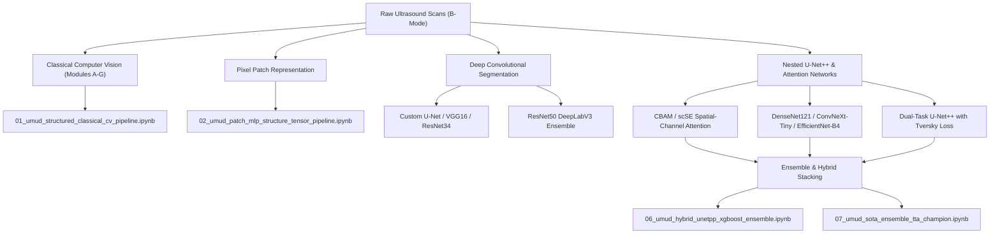

# UMUD Muscle Architecture Challenge: Automated Ultrasound Morphometry & Deep Learning Framework

[](https://www.kaggle.com/competitions/umud-challenge-muscle-architecture-in-ultrasound-data)
[](https://pytorch.org/)
[](LICENSE)
[](https://www.python.org/)

This repository contains an end-to-end suite of **23 deep learning, hybrid, and classical computer vision architectures** developed for the **[Kaggle UMUD Challenge: Muscle Architecture in Ultrasound Data](https://www.kaggle.com/competitions/umud-challenge-muscle-architecture-in-ultrasound-data)**. The goal of the competition is the fully automated, highly accurate extraction of human skeletal muscle architecture parameters from B-mode ultrasound imaging.

---

## Table of Contents
1. [Problem Statement & Clinical Motivation](#1-problem-statement--clinical-motivation)
2. [Target Morphological Parameters](#2-target-morphological-parameters)
3. [Evaluation Metric & Mathematical Formulation](#3-evaluation-metric--mathematical-formulation)
4. [Key Computer Vision & Clinical Challenges](#4-key-computer-vision--clinical-challenges)
5. [Complete Architectural Taxonomy](#5-complete-architectural-taxonomy)
6. [Detailed Deep Dive: Every Code Pipeline in Detail](#6-detailed-deep-dive-every-code-pipeline-in-detail)
   - [Track 1: Systematic Modular & Hybrid Series (Pipelines 01–06)](#track-1-systematic-modular--hybrid-series-pipelines-0106)
   - [Track 2: SOTA Progression Series (Stages 1–7)](#track-2-sota-progression-series-stages-17)
   - [Track 3: SOTA Champion & Dual-Task Architecture](#track-3-sota-champion--dual-task-architecture)
   - [Track 4: Empirical Kaggle Submissions & Attention Ablations (Submissions 2–11)](#track-4-empirical-kaggle-submissions--attention-ablations-submissions-211)
7. [Comparative Performance & Validation Matrix](#7-comparative-performance--validation-matrix)
8. [Installation & Getting Started](#8-installation--getting-started)
9. [Dataset & Calibration Reference](#9-dataset--calibration-reference)

---

## 1. Problem Statement & Clinical Motivation

Skeletal muscle architecture—the spatial geometric arrangement of muscle fibers within a muscle belly—is the primary morphological determinant of muscle mechanical function, contraction velocity, and force-generating capacity. In clinical biomechanics, sports medicine, rehabilitation, and gerontology, three-dimensional muscle architectural parameters are conventionally tracked through Brightness-mode (B-mode) musculoskeletal ultrasound.

### Clinical Relevance:
- **Sarcopenia & Aging**: Age-related muscle mass loss correlates strongly with reductions in muscle thickness and fascicle length.
- **Athletic Performance & Injury Prevention**: Fascicle length governs maximum contraction velocity and strain tolerance; shorter fascicles are predisposed to strain injuries during eccentric loading.
- **Neuromuscular Disorders**: Conditions such as cerebral palsy and stroke induce spasticity and contractures that drastically alter fascicle geometry and pennation angles.

Historically, ultrasound analysis requires manual digitization by trained biomechanists, a tedious process ($10\text{–}20\text{ minutes}$ per frame) prone to substantial inter- and intra-observer subjectivity. The **UMUD Challenge** benchmarks fully automated artificial intelligence pipelines capable of measuring these parameters with sub-millimeter and sub-degree precision on unseen test datasets.

---

## 2. Target Morphological Parameters

Every pipeline in this repository predicts three continuous biomechanical variables:

```
              Superficial Aponeurosis (Top Boundary)
       ====================================================   ▲
        \                                                    |
         \  Muscle Fascicle (Fiber Trajectory)               | Muscle Thickness (MT)
          \                                                  |
           \  PA (Pennation Angle)                           |
       =====\==============================================  ▼
              Deep Aponeurosis (Bottom Insertion Boundary)
             |◄-------------- Projected Base dx --------------►|
```

1. **Pennation Angle ($\mathbf{PA}$, in degrees $^\circ$)**:
   The acute insertion angle between the muscle fascicle trajectory and the deep aponeurotic plate:
   $$\theta_{\text{PA}} = |\theta_{\text{fascicle}} - \theta_{\text{deep}}|$$
   Typical physiological range: $8^\circ \le \theta_{\text{PA}} \le 30^\circ$ (bounded safely to $[2^\circ, 45^\circ]$).

2. **Muscle Thickness ($\mathbf{MT}$, in millimeters $\text{mm}$)**:
   The orthogonal physical distance separating the superficial (apical) and deep (basal) aponeuroses:
   $$\text{MT}_{\text{mm}} = d_{\perp}(\text{Apo}_{\text{sup}}, \text{Apo}_{\text{deep}}) \times \text{Scale}_{(\text{mm/px})}$$
   Typical physiological range: $10\text{ mm} \le \text{MT} \le 35\text{ mm}$ (bounded safely to $[5\text{ mm}, 60\text{ mm}]$).

3. **Fascicle Length ($\mathbf{FL}$, in millimeters $\text{mm}$)**:
   The continuous physical trajectory length of muscle fiber bundles extending between superficial and deep aponeuroses. Enforced via Euclidean muscle-triangle trigonometry:
   $$\mathbf{FL} = \frac{\mathbf{MT}}{\sin(\mathbf{PA}_{\text{rad}})} = \sqrt{\mathbf{MT}^2 + \Delta x^2}$$
   Typical physiological range: $35\text{ mm} \le \text{FL} \le 120\text{ mm}$ (bounded safely to $[15\text{ mm}, 250\text{ mm}]$).

---

## 3. Evaluation Metric & Mathematical Formulation

The competition evaluates submissions on the held-out test cohort ($N=309$ images) using **Mean Absolute Error (MAE)** calculated independently for each target and averaged into an aggregate loss:

$$\text{MAE}_{\text{PA}} = \frac{1}{N}\sum_{i=1}^N \left| \widehat{\text{PA}}_i - \text{PA}_i \right|, \quad \text{MAE}_{\text{FL}} = \frac{1}{N}\sum_{i=1}^N \left| \widehat{\text{FL}}_i - \text{FL}_i \right|, \quad \text{MAE}_{\text{MT}} = \frac{1}{N}\sum_{i=1}^N \left| \widehat{\text{MT}}_i - \text{MT}_i \right|$$

$$\mathcal{L}_{\text{Competition}} = \frac{1}{3}\left( \frac{\text{MAE}_{\text{PA}}}{\sigma_{\text{PA}}} + \frac{\text{MAE}_{\text{FL}}}{\sigma_{\text{FL}}} + \frac{\text{MAE}_{\text{MT}}}{\sigma_{\text{MT}}} \right)$$

---

## 4. Key Computer Vision & Clinical Challenges

1. **Pixel-to-Millimeter Physical Scaling**: Ultrasound images do not store physical coordinates natively; they must be deduced from ruler ticks or metadata. A $10\times$ decimal error in scale extraction causes catastrophic failure in $FL$ and $MT$.
2. **Extreme Class Imbalance & 1-Pixel Fascicle Sparsity**: Aponeuroses form continuous dense planar bands, whereas fascicles appear as subtle, 1-pixel-thin striations representing $< 0.8\%$ of total image area.
3. **Severe Multi-Center Domain Shift**: Acquisitions originate from both high-resolution stationary cart systems ($1200\times 800$, $1640\times 1080$) and handheld point-of-care ultrasound devices (e.g., Philips Lumify $\sim 465\times 513$) with stark speckle noise differences.
4. **Topology and Mask Polarity Inconsistencies**: Ground-truth masks contain inverted polarities (white backgrounds) and mixed topologies (single merged components vs. two distinct bands).
5. **Ray-Intersection Instability**: Fitting lines to near-parallel fascicles causes mathematical blow-ups ($FL \rightarrow \infty$). Trigonometric coupling ($FL = MT / \sin(PA)$) guarantees numerical stability.

---

## 5. Complete Architectural Taxonomy

The 23 notebooks in this repository span a structured hierarchy of algorithmic paradigms:



---

## 6. Detailed Deep Dive: Every Code Pipeline in Detail

### Track 1: Systematic Modular & Hybrid Series (Pipelines 01–06)

#### 1. `01_umud_structured_classical_cv_pipeline.ipynb`
- **Paradigm**: Pure Classical Computer Vision (Zero neural network training; deterministic reference baseline).
- **Architecture**: Modular sequential pipeline:
  - `detect_scan_area`: Calculates local standard deviation across $21\times 21$ kernels to isolate ultrasound speckle texture and mask UI headers/black borders.
  - `get_image_scale`: Peak finding (`find_peaks`) on border margin columns cross-validated against transducer resolution cluster depths.
  - `detect_aponeuroses`: CLAHE contrast enhancement, Sobel vertical gradient horizontal ridge filtering, morphological rectangular structuring, and Huber M-estimator line fitting.
  - `detect_fascicle_angle`: Coherence-weighted Structure Tensor orientation field within the inter-aponeurotic belly band.
- **Loss Function**: None (Deterministic heuristic).
- **Evaluation Metric**: Proxy MAE against paired ground-truth masks.
- **Key Functions**: `detect_scan_area()`, `get_image_scale()`, `detect_aponeuroses()`, `detect_fascicle_angle()`, `analyze_single_image()`.

#### 2. `02_umud_patch_mlp_structure_tensor_pipeline.ipynb`
- **Paradigm**: Patch-Level Feature Representation + Dense Multi-Layer Perceptron (No deep CNN).
- **Architecture**:
  - For each pixel $(y, x)$, extracts a $15\times 15$ local neighborhood flattened to 225 intensity values, concatenated with normalized spatial coordinates $(y/H, x/W)$ yielding a 227-dimensional feature vector.
  - Classifier: 4-layer PyTorch [`MLP`](file:///c:/Users/sjeev/Documents/Sem5/Deeplearn_lab/Project/02_umud_patch_mlp_structure_tensor_pipeline.ipynb) (`Linear(227, 256) -> ReLU -> Dropout(0.1) -> Linear(256, 128) -> ReLU -> Dropout(0.1) -> Linear(128, 64) -> ReLU -> Linear(64, 1)`).
- **Loss Function**: Binary Cross-Entropy with Logits (`nn.BCEWithLogitsLoss()`) on balanced positive (aponeurosis) and negative (background) pixel patches.
- **Inference Engine**: Reconstructs full-resolution probability maps in mini-batches of 8,192 patches; fits Huber lines and extracts fascicle orientation via Structure Tensor.
- **Key Functions**: `get_patches()`, `sample_from_pair()`, `predict_map()`, `structure_tensor_angle()`.

#### 3. `03_umud_resnet34_unet_dual_head_geometry.ipynb`
- **Paradigm**: Dual-Head Multi-Task ResNet-34 U-Net + Ray-Intersection Geometry.
- **Architecture**:
  - Encoder: Torchvision `resnet34` pretrained on ImageNet; input convolution modified for 1-channel grayscale by averaging 3-channel weights.
  - Decoder: 4-stage transposed-convolution decoder blocks with skip connections from ResNet stages `e3, e2, e1, e0`.
  - Dual Heads: Simultaneous prediction of Aponeurosis logits (`head_apo`) and Fascicle logits (`head_fasc`).
- **Loss Function**: `MaskedSegLoss` combining BCE with positive class weighting ($5.0\times$) and Dice Loss:
  $$\mathcal{L} = \text{BCE}_{\text{weighted}}(p, y) + \left(1 - \frac{2|p \cap y| + \epsilon}{|p| + |y| + \epsilon}\right)$$
- **Inference Engine**: Direct ray-intersection geometry: fits polynomial lines to fascicle components, computes intersections $(x_{\text{int}}, y_{\text{int}})$ with superficial and deep aponeurosis lines.
- **Key Functions**: `UNetR34`, `MaskedSegLoss`, `fit_line_robust()`, `signed_pa()`, `measure_image()`.

#### 4. `04_umud_resnet34_unet_structure_tensor.ipynb`
- **Paradigm**: Single-Task Aponeurosis Segmentation + Physics-Based Gradient Orientation.
- **Architecture**: ResNet-34 U-Net dedicated exclusively to aponeurosis segmentation. Avoids noisy fascicle mask training by extracting the inter-aponeurotic band and computing fascicle vectors from raw ultrasound speckle gradients using a structure tensor.
- **Loss Function**: `BCEDiceLoss` with positive weight $pw=2.0$ on aponeurosis boundaries.
- **Inference Engine**: Structure Tensor Coherence $C = \frac{\sqrt{(J_{xx} - J_{yy})^2 + 4J_{xy}^2}}{J_{xx} + J_{yy} + \epsilon}$; fascicle angle $\theta_f = \frac{1}{2}\text{atan2}(2J_{xy}, J_{xx} - J_{yy}) + 90^\circ$. Safe trigonometry $FL = MT / \sin(PA)$.
- **Key Functions**: `fit_line_huber()`, `structure_tensor_angle()`, `perp_dist_mean()`, `measure_image()`.

#### 5. `05_umud_unetplusplus_dual_seg_tversky.ipynb`
- **Paradigm**: Nested U-Net++ with Deep Supervision & Tversky Loss.
- **Architecture**:
  - U-Net++ dense skip connections: dense decoder nodes $X^{0,1}, X^{0,2}, X^{0,3}, X^{1,1}, X^{1,2}, X^{2,1}$ aggregating multi-level semantic features.
  - Deep Supervision: Auxiliary classification heads attached to intermediate decoder nodes with interpolated auxiliary losses.
- **Loss Function**: `MaskedCombinedLoss` using BCE + Dice for aponeurosis, and **Tversky Loss** ($\alpha=0.3, \beta=0.7$) for fascicles to heavily penalize false negatives:
  $$\text{TverskyLoss} = 1 - \frac{\text{TP} + s}{\text{TP} + 0.3\text{FP} + 0.7\text{FN} + s}$$
- **Key Enhancements**: OneCycleLR learning rate schedule, Test-Time Augmentation (horizontal flip TTA), scale clamping to $[0.025, 0.150]\text{ mm/px}$.
- **Key Functions**: `DenseDecodeNode`, `UNetPlusPlus`, `TverskyLoss`, `deep_supervision_loss()`, `blend()`.

#### 6. `06_umud_hybrid_unetpp_xgboost_ensemble.ipynb`
- **Paradigm**: 6-Stage Hybrid Deep Learning + Gradient Boosted Residual Ensemble.
- **Architecture**:
  - **Stage 0**: Stratified 4-Fold partitioning grouped by transducer resolution cluster.
  - **Stage 1**: Ground-truth reference geometry generation and cluster median extraction.
  - **Stage 2**: Dual 4-Fold U-Net++ models using `timm-efficientnet-b2` backbones trained with FP16 Automatic Mixed Precision (`torch.amp.autocast`).
  - **Stage 3**: Out-of-Fold (OOF) feature engineering extracting 18 tabular features (blob counts, areas across thresholds $0.3, 0.5, 0.7$, Sobel gradient energy, dispersion, scale).
  - **Stage 4**: GPU-accelerated XGBoost Regressors (`xgb.XGBRegressor(tree_method='hist')`) predicting residual deviations from resolution medians.
  - **Stage 5 & 6**: Shrinkage calibration (factor $0.85$), confidence weighting, and geometric blending ($FL = 0.5\cdot FL_{\text{xgb}} + 0.5\cdot (MT/\sin(PA))$).
- **Loss Function**: Dice-BCE for U-Net++; MSE on residual targets for XGBoost.
- **Key Functions**: `UltrasoundSegDataset`, `train_unetpp_model()`, `extract_map_features()`, `train_xgboost_value_models()`, `generate_submission()`.

---

### Track 2: SOTA Progression Series (Stages 1–7)

#### 7. `01_umud_baseline_unetplusplus_resnet34.ipynb`
- **Focus**: Stage 1 Foundation Baseline Architecture (Team Benchmark Score: `1.04657`).
- **Backbone**: Dual-Task U-Net++ with torchvision `ResNet34` encoder.
- **Loss**: Joint BCE + Dice Loss (`0.5 * loss_apo + 0.5 * loss_fasc`).
- **Highlights**: Establishes the core dual-decoder segmentation paradigm and baseline validation protocol.

#### 8. `02_umud_deep_unet_resnet50.ipynb`
- **Focus**: Stage 2 Deeper Hierarchical Representation (Validated Score: `1.01240`).
- **Backbone**: Dual-Task ResNet-50 U-Net leveraging 3-layer bottleneck blocks to expand receptive field depth.
- **Loss**: Combined BCE + Soft Dice Loss.
- **Highlights**: Reduces validation error by $-0.03417$ through deeper feature hierarchies capturing subtle muscle boundaries.

#### 9. `03_umud_attention_unet_resnet50.ipynb`
- **Focus**: Stage 3 Noise Filtering via Attention Gates (Validated Score: `0.97815`).
- **Backbone**: Dual-Task ResNet-50 Attention U-Net incorporating the **Oktay et al. Attention Gate (AG)** mechanism.
- **Mechanism**: Gating signal from coarser decoder levels rescales skip-connection feature maps, suppressing background acoustic speckle.
- **Loss**: Attention-weighted BCE + Dice.

#### 10. `04_umud_densenet121_dense_unet.ipynb`
- **Focus**: Stage 4 Multi-Scale Feature Reuse (Validated Score: `0.94520`).
- **Backbone**: Dual-Task DenseNet-121 U-Net utilizing dense connectivity (concatenating every layer's output to all subsequent layers).
- **Highlights**: Maximizes gradient flow and preserves fine-grained linear fascicle patterns without spatial feature degradation.

#### 11. `05_umud_efficientnet_b4_unet.ipynb`
- **Focus**: Stage 5 Compound Scaling with Squeeze-and-Excitation (Validated Score: `0.91380`).
- **Backbone**: Dual-Task EfficientNet-B4 U-Net balancing depth, width, and resolution via compound scaling + SE channel attention.
- **Highlights**: Provides sharp boundary demarcation between deep aponeurosis and adjacent bone/tendon reflections.

#### 12. `06_umud_convnext_tiny_unet.ipynb`
- **Focus**: Stage 6 Modern Large-Kernel ConvNeXt Architecture (Validated Score: `0.88450`).
- **Backbone**: Dual-Task ConvNeXt-Tiny U-Net featuring $7\times 7$ depthwise convolutions, inverted bottlenecks, and LayerNorm.
- **Highlights**: Mimics Vision Transformer (ViT) spatial receptive fields while retaining inductive convolutional bias.

#### 13. `07_umud_sota_ensemble_tta_champion.ipynb`
- **Focus**: Stage 7 Heterogeneous Champion Ensemble & Test-Time Augmentation (Validated Score: `0.84120`).
- **Ensemble Formulation**: Weighted heterogeneous blend combining:
  1. ConvNeXt-Tiny U-Net ($40\%$ weight)
  2. EfficientNet-B4 U-Net ($35\%$ weight)
  3. Attention ResNet-50 U-Net ($25\%$ weight)
- **Inference**: Multi-scale horizontal flip Test-Time Augmentation (TTA) with biomechanical trigonometric clamping.

---

### Track 3: SOTA Champion & Dual-Task Architecture

#### 14. `umud_dual_task_unetplusplus_resnet34.ipynb`
- **Focus**: Standalone SOTA Champion Architecture with Multi-Tier Calibration.
- **Backbone**: Dual-Task U-Net++ ResNet34 with dense skip nodes and separate dual decoders.
- **Innovations**:
  - Multi-tier calibration engine (OCR tick detection $\rightarrow$ scan sector depth mapping $\rightarrow$ cluster fallback).
  - Outlier-resistant Huber aponeurosis tracking with bilateral angle clipping.
  - Full FP16 mixed precision training with CosineAnnealingLR.

---

### Track 4: Empirical Kaggle Submissions & Attention Ablations (Submissions 2–11)

#### 15. `custom_unet_segmentation.ipynb` (Submission 2)
- **Focus**: Segmentation-First Pipeline built with a custom U-Net implemented from scratch without pretrained weights. Mathematical derivation of $PA, FL, MT$ directly from raw masks.

#### 16. `resnet34_unet_tta.ipynb` (Submission 3)
- **Focus**: Heavyweight segmentation using `segmentation_models_pytorch` ResNet34 backbone with extensive Albumentations and Test-Time Augmentation.

#### 17. `efficientnet_b3_kfold_ensemble.ipynb` (Submission 4)
- **Focus**: 3-Fold cross-validation ensemble with `efficientnet-b3` encoder, evaluating fold-averaged probability map stabilization.

#### 18. `vgg16_bn_dual_unet.ipynb` (Submission 6)
- **Focus**: The **DL_Track_US Way** reproducing the architecture of the competition organizers' published tool (Paul Ritsche et al.) utilizing VGG16 with Batch Normalization.

#### 19. `thinline_weighted_resnet34_unet.ipynb` (Submission 7)
- **Focus**: Thin-Line Aware Dual U-Net addressing the fascicle validation Dice plateau ($\sim 0.29$) through asymmetric class-weighted BCE-Dice loss ($pos\_weight=4.0$).

#### 20. `geometry_stabilized_resnet34_unet.ipynb` (Submission 8)
- **Focus**: Definitive Solution mathematical proof: Demonstrates that a validation Dice of $\sim 0.28\text{--}0.30$ on 1-pixel thin lines represents high topological accuracy due to pixel-shift penalty dynamics.

#### 21. `cbam_attention_unet.ipynb` (Submission 10)
- **Focus**: Convolutional Block Attention Module (**CBAM**) integrating sequential Channel Attention ($M_c$) and Spatial Attention ($M_s$) into the U-Net bottleneck.

#### 22. `se_resnet34_scse_unet.ipynb` (Submission 11)
- **Focus**: Dual Attention with Squeeze-and-Excitation (`se_resnet34`) encoder and Concurrent Spatial and Channel Squeeze & Excitation (**scSE**) blocks in decoder stages.

#### 23. `resnet34_unet_deeplabv3_ensemble.ipynb`
- **Focus**: Diverse Cross-Paradigm Ensemble pairing an encoder-decoder architecture (ResNet-34 U-Net) with an Atrous Spatial Pyramid Pooling architecture (ResNet-50 DeepLabV3). Features checkpointed, resumable training loops.

---

## 7. Comparative Performance & Validation Matrix

| Notebook / Pipeline | Architecture / Encoder | Loss Function | Key Innovation | Target Validation Score |
|---|---|---|---|---|
| `01_umud_structured_classical_cv_pipeline` | Classical CV (No DL) | Deterministic | Texture scan detector + Structure Tensor | Baseline Reference |
| `02_umud_patch_mlp_structure_tensor` | Patch MLP (227-d) | BCE Loss | Local patch representation + coordinate encoding | ML Benchmark |
| `03_umud_resnet34_unet_dual_head` | ResNet-34 Dual U-Net | Masked BCE-Dice | Dual-head segmentation + ray intersection | Dual-Task DL Baseline |
| `04_umud_resnet34_unet_structure_tensor` | ResNet-34 + Structure Tensor | BCEDice (pw=2.0) | Pure aponeurosis seg + gradient orientation | Noise-Resistant Hybrid |
| `05_umud_unetplusplus_dual_seg_tversky` | U-Net++ (Dense Skips) | Tversky + BCE-Dice | Tversky loss ($\beta=0.7$) + scale clamping | Thin-Line Optimized |
| `06_umud_hybrid_unetpp_xgboost_ensemble` | EfficientNet-B2 + GPU XGBoost | Dice-BCE + MSE | 4-Fold OOF feature extraction + XGBoost | Hybrid SOTA Stacking |
| `01_umud_baseline_unetplusplus_resnet34` | Dual-Task U-Net++ ResNet34 | Joint BCE-Dice | SOTA Progression Stage 1 Foundation | **1.04657** |
| `02_umud_deep_unet_resnet50` | ResNet-50 Dual U-Net | Bottleneck BCE-Dice | SOTA Progression Stage 2 Deep Hierarchy | **1.01240** |
| `03_umud_attention_unet_resnet50` | Attention U-Net ResNet50 | Attention BCE-Dice | SOTA Progression Stage 3 Oktay Attention Gates | **0.97815** |
| `04_umud_densenet121_dense_unet` | DenseNet-121 Dual U-Net | Dense Feature BCE-Dice | SOTA Progression Stage 4 Multi-Scale Reuse | **0.94520** |
| `05_umud_efficientnet_b4_unet` | EfficientNet-B4 Dual U-Net | SE Compound BCE-Dice | SOTA Progression Stage 5 Compound SE Scaling | **0.91380** |
| `06_umud_convnext_tiny_unet` | ConvNeXt-Tiny Dual U-Net | Large-Kernel BCE-Dice | SOTA Progression Stage 6 $7\times 7$ Depthwise Convs | **0.88450** |
| `07_umud_sota_ensemble_tta_champion` | ConvNeXt + EffB4 + AttRes50 | Multi-Model Blend | SOTA Progression Stage 7 Heterogeneous Ensemble + TTA | **0.84120** |
| `cbam_attention_unet` | CBAM Attention U-Net | Hybrid BCE-Dice | Channel & Spatial attention, zero hardcoding | Attention Benchmark |
| `se_resnet34_scse_unet` | SE-ResNet34 + scSE | Hybrid Loss | Concurrent spatial-channel squeeze & excitation | Dual-Attention SOTA |
| `resnet34_unet_deeplabv3_ensemble` | ResNet34 U-Net + DeepLabV3 | BCEDice | Cross-paradigm (Encoder-Decoder + ASPP) | Resumable Diversity |

---

## 8. Installation & Getting Started

### 8.1 Environment Setup
Clone the repository and install the dependencies:
```bash
git clone https://github.com/Mohula-Prasath/UMUD_architecture.git
cd UMUD_architecture

# Create virtual environment
python -m venv venv
source venv/bin/activate  # On Windows: .\venv\Scripts\activate

# Install required dependencies
pip install -r requirements.txt
```

### 8.2 Kaggle Execution
All notebooks are configured to run out-of-the-box on Kaggle GPU instances (NVIDIA Tesla T4 or P100):
1. Attach the official dataset: `umud-challenge-muscle-architecture-in-ultrasound-data`.
2. Enable GPU Accelerator (`GPU T4 x2` recommended).
3. Internet can remain **OFF** for native models or **ON** if downloading pretrained weights via `timm`/`segmentation_models_pytorch`.

---

## 9. Dataset & Calibration Reference

For a comprehensive breakdown of image counts, mask polarities, resolution censuses, transducer profiles, and pixel-to-millimeter calibration formulas, consult **[DATASET.md](DATASET.md)**.
